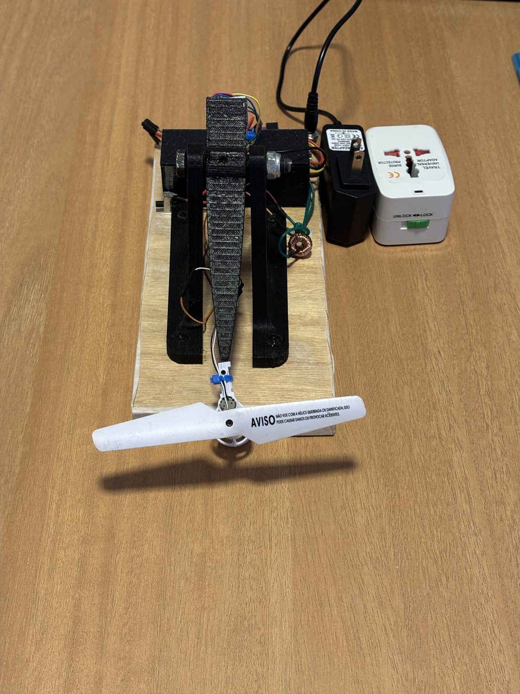

# 1-DOF Copter Control: controle em tempo real de uma haste 1DOF com FreeRTOS (STM32F103)



Repositório: <https://github.com/rickelmedias/1-DOF-Copter-Control>

## Vídeo

[](https://www.youtube.com/watch?v=UdPdqLyjeSY)

<https://www.youtube.com/watch?v=UdPdqLyjeSY>

Plataforma de estabilização ativa por empuxo: uma haste com um grau de liberdade, motor e hélice em uma ponta e sensor inercial MPU6050 na outra, mantida na horizontal por um PID rodando em FreeRTOS em uma Blue Pill (STM32F103). Projeto da disciplina **Tópicos Especiais em Engenharia da Computação II**, Centro Universitário Facens. O trabalho usa a haste como exemplo de **sistema de controle crítico** para aplicar sistemas operacionais de tempo real.

## Estrutura do repositório

```
.
├── firmware/            Projeto STM32CubeIDE (C, FreeRTOS)
│   ├── Modules/         Código do projeto: app, control (PID), sensor (MPU6050 e filtro), motor, serial, debug
│   ├── Core/            Código gerado pelo CubeMX (main, periféricos, FreeRTOS)
│   ├── Drivers/ Middlewares/   HAL, CMSIS e FreeRTOS V10.3.1
│   ├── release/         Binário final (.hex/.bin) para gravar sem compilar
│   ├── tools/           Leitura de diagnóstico pelo ST-Link e captura de dados (Python)
│   ├── tests/           Teste da lógica de controle no PC (C)
│   ├── docs/            Notas de hardware (acionamento do motor)
│   └── topicos2.ioc     Configuração do CubeMX
├── report/              Texto do trabalho em LaTeX (abnTeX2) e scripts de simulação e gráficos
│   ├── main.tex, parts/, references.bib
│   ├── simulation/      Simulação do braço e geração dos gráficos (Python)
│   └── images/          Figuras (inclusive as geradas pelos scripts)
└── data/                Dados medidos na bancada (CSV e leituras brutas)
```

## Hardware

Blue Pill (STM32F103C8T6), módulo MPU6050 (GY-521), módulo driver DRV8871, motor *coreless* 0720 (3,7 V) com hélice, indutor de 220 µH / 3 A em série com o motor, fonte de 12 V, BEC 12 V para 5 V, chave liga/desliga dos 5 V da lógica e ST-Link V2. O diagrama de ligações está em `report/images/hardware/esquema_ligacoes.pdf`.

| STM32 | Ligação |
|---|---|
| PA8 / PA9 (TIM1 CH1/CH2) | IN1 / IN2 do DRV8871 (PWM de 100 kHz) |
| PB6 / PB7 (I²C1, 400 kHz) | SCL / SDA do MPU6050 |
| PA2 / PA3 (USART2) | Serial opcional, 115200 8N1 |
| PA13 / PA14 | SWDIO / SWCLK (ST-Link) |
| PC13 | LED de estado |

## Firmware

Três tarefas FreeRTOS: `control` (prioridade 3, a cada 5 ms por semáforo do TIM2: lê o MPU6050, filtra o ângulo, calcula o PID e atualiza o PWM), `cmd` (comandos pela serial) e `telem` (telemetria e LED). Dados compartilhados protegidos por *mutex*. Todos os ajustes ficam em `firmware/Modules/app/app_config.h`.

Versões: STM32CubeIDE 2.2.0, STM32Cube FW_F1 V1.8.7, FreeRTOS V10.3.1, GNU Tools for STM32 14.3.rel1, STM32CubeProgrammer 2.23.0.

**Compilar e gravar:** importe `firmware/` no STM32CubeIDE (*File > Import > Existing Projects into Workspace*), compile (Debug) e grave por ST-Link. O nome interno do projeto continua `topicos2`.

**Gravar sem compilar:** o binário final está em `firmware/release/` (`.hex`, `.bin` e um README com o comando do STM32CubeProgrammer), para regravar a placa se o projeto for perdido ou refeito.

**Diagnóstico sem serial** (lê a RAM pelo ST-Link, sem parar o firmware), a partir de `firmware/`:

```sh
python3 tools/dbg_read.py --log                 # estado, tempos, histogramas e registro de 16 s
python3 tools/dbg_read.py --set ki=0.08 aw=1    # muda ganhos ao vivo
python3 tools/dbg_read.py --set motor=0         # desliga o motor
```

Precisa do STM32CubeProgrammer e do `Debug/topicos2.elf` compilado. O firmware **arma o motor sozinho cerca de 2 s depois de ligar** (calibração com a haste parada), e desliga se o ângulo passar de +60° ou de −90° ou se o sensor parar de responder.

**Teste da lógica de controle no PC** (a partir de `firmware/`):

```sh
gcc -Wall -Wextra -IModules/app -IModules/control -IModules/sensor tests/sim_control.c \
    Modules/control/control.c Modules/control/pid.c Modules/sensor/angle_filter.c -lm -o sim_control && ./sim_control
```

## Reproduzir os gráficos

```sh
pip install -r requirements.txt
cd report/simulation
python3 sim_1dof.py               # simulação com a planta identificada, anti-windup
python3 valida_com_dados.py       # partida real contra simulação, filtro com e sem acelerômetro
python3 histogramas_tempo.py      # latência e intervalo entre interrupções
python3 refino_graficos.py        # refino do PID, regime
python3 refino_degraus.py         # refino do PID, degraus
python3 esquema_ligacoes.py       # diagrama de ligações
```

Os dados vêm de `data/` e as figuras vão para `report/images/`.

## Relatório

Compilação em `report/COMPILACAO.md`. O texto segue a ordem do projeto: sistema crítico e RTOS, modelagem e simulação, materiais e montagem, firmware, dificuldades, resultados e refino.

## Resultados principais (medidos na bancada)

- Ciclo de controle de 5 ms: latência da interrupção até o PWM de no máximo 580 µs (média 558 µs), nenhum tick perdido em 34 870 ciclos.
- Em regime, erro quadrático médio de 0,28° em 60 s.
- Refino do PID: Ki de 0,05 para 0,08 reduziu em 28% o erro acumulado nos degraus de setpoint.

## Licença e créditos

Os diretórios `firmware/Drivers` e `firmware/Middlewares` trazem código de terceiros (STMicroelectronics e FreeRTOS) sob as respectivas licenças. Escolha uma licença para o restante antes de publicar. Integrantes e orientação: ver o relatório.
