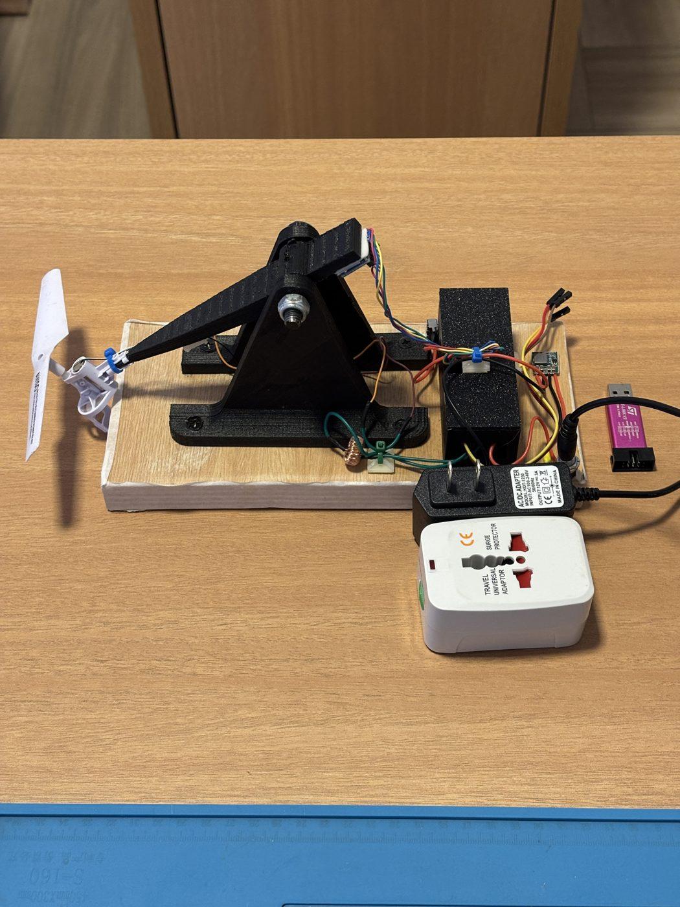

# 1-DOF Copter Control

Plataforma de estabilização ativa por empuxo: uma haste de um grau de liberdade, com motor e hélice em uma ponta e sensor inercial MPU6050 na outra, mantida na horizontal por um PID rodando em FreeRTOS em uma Blue Pill (STM32F103).

  

<a href="https://www.youtube.com/watch?v=bEUd74-upSc">Vídeo do protótipo funcionando</a>

## Getting started: o que é e como funciona

A cada 5 ms o TIM2 libera um semáforo que acorda a tarefa de controle, de maior prioridade. Ela lê o MPU6050 por I²C, estima o ângulo com um filtro complementar (giroscópio corrigido devagar pelo acelerômetro), calcula o PID com derivada filtrada e anti-*windup* e atualiza o PWM de 100 kHz do driver do motor. Comandos pela serial e telemetria rodam em tarefas de menor prioridade, sem atrasar o laço. O motor desliga sozinho se o ângulo sair da faixa segura ou se o sensor parar de responder.

## Resultados

Medidos na bancada, com o firmware final:

- Ciclo de 5 ms com latência da interrupção até o PWM de no máximo 580 µs (média 558 µs) e nenhum tick perdido em 34 870 ciclos.
- Erro RMS de 0,28° em regime (60 s).
- Refino do PID (Ki de 0,05 para 0,08): erro acumulado nos degraus de *setpoint* 28% menor.

## Hardware

- Blue Pill (STM32F103C8T6)
- MPU6050 (módulo GY-521)
- Driver DRV8871
- Motor *coreless* 0720 (3,7 V) com hélice
- Indutor de 220 µH / 3 A em série com o motor
- Fonte de 12 V e BEC 12 V → 5 V
- ST-Link V2

O diagrama de ligações está em `report/images/hardware/esquema_ligacoes.pdf`.

## Firmware

C sobre FreeRTOS (V10.3.1, CMSIS-RTOS), com três tarefas: `control` (laço de 5 ms), `cmd` (serial) e `telem` (telemetria e LED). O código próprio fica em `firmware/Modules/`:

- `app`: criação das tarefas e configuração (`app_config.h`)
- `control`: PID e lógica de armar/desarmar o motor
- `sensor`: driver do MPU6050 e filtro de ângulo
- `motor`: PWM do DRV8871
- `serial`: comandos e telemetria pela USART2
- `debug`: variáveis de diagnóstico lidas pelo ST-Link sem parar o firmware

Compilado no STM32CubeIDE e gravado por ST-Link; o binário final está em `firmware/release/`.

## Estrutura do repositório

- `firmware/`: projeto STM32CubeIDE, com ferramentas de diagnóstico em Python (`tools/`) e teste da lógica de controle no PC (`tests/`)
- `report/`: texto em LaTeX, figuras e scripts de simulação e gráficos
- `data/`: dados medidos na bancada (CSV e leituras brutas)

## Relatório

O PDF do relatório ficará na raiz do repositório (em finalização).

## Licença

O código próprio está sob a licença [MIT](LICENSE). `firmware/Drivers` (STMicroelectronics: HAL sob BSD-3-Clause, CMSIS sob Apache-2.0) e `firmware/Middlewares` (FreeRTOS, MIT) mantêm suas licenças originais.
